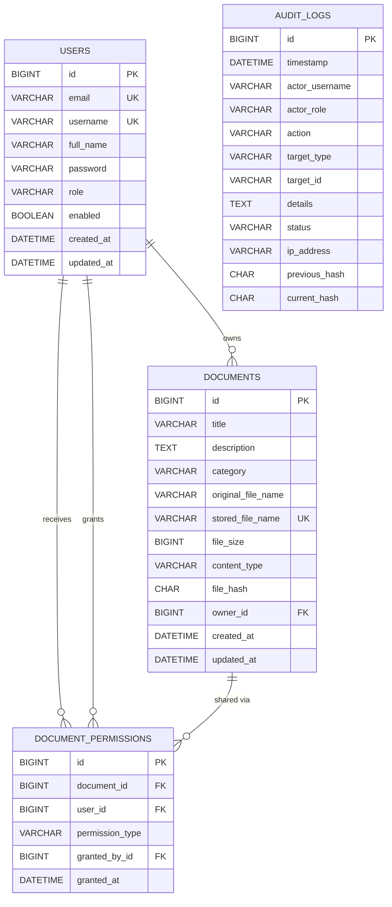

# TrustVault — Database Architecture & Schema Specification

TrustVault supports **PostgreSQL 15+ / Supabase** and **MySQL 8.0+ / 26.x** for production environments, alongside an **In-Memory H2 Engine** for rapid, zero-configuration local development and automated testing.

---

## 1. Entity-Relationship Diagram



---

## 2. Table Definitions & Constraints

### 2.1 `users`
* `id` (`BIGINT`, Auto-increment, Primary Key)
* `email` (`VARCHAR(100)`, Unique, Not Null) — Email identifier for authentication.
* `username` (`VARCHAR(60)`, Unique, Not Null) — Handle used across UI and logs.
* `full_name` (`VARCHAR(100)`, Not Null) — User's display name.
* `password` (`VARCHAR(255)`, Not Null) — BCrypt password hash (cost factor 12).
* `role` (`VARCHAR(20)`, Not Null) — `ROLE_ADMIN`, `ROLE_OWNER`, or `ROLE_VIEWER`.
* `enabled` (`BOOLEAN`, Default `TRUE`) — Account active status.
* `created_at` / `updated_at` (`DATETIME(6)`) — Audit timestamps.

### 2.2 `documents`
* `id` (`BIGINT`, Auto-increment, Primary Key)
* `title` (`VARCHAR(150)`, Not Null) — Title of the document.
* `description` (`TEXT`) — Markdown / text description.
* `category` (`VARCHAR(50)`, Not Null) — `Financial`, `Legal`, `Confidential`, `Technical`, `Personal`, `General`.
* `original_file_name` (`VARCHAR(255)`, Not Null) — Sanitized original filename.
* `stored_file_name` (`VARCHAR(255)`, Unique, Not Null) — Randomized UUID filename on private disk.
* `file_size` (`BIGINT`, Not Null) — File size in bytes.
* `content_type` (`VARCHAR(100)`, Not Null) — MIME type.
* `file_hash` (`CHAR(64)`, Not Null) — SHA-256 cryptographic digest of raw file content.
* `owner_id` (`BIGINT`, Foreign Key `users.id`, `ON DELETE CASCADE`) — Document owner.

### 2.3 `document_permissions`
* `id` (`BIGINT`, Auto-increment, Primary Key)
* `document_id` (`BIGINT`, Foreign Key `documents.id`, `ON DELETE CASCADE`)
* `user_id` (`BIGINT`, Foreign Key `users.id`, `ON DELETE CASCADE`)
* `permission_type` (`VARCHAR(20)`, Not Null) — `READ` or `EDIT`.
* `granted_by_id` (`BIGINT`, Foreign Key `users.id`) — Granter user.
* `granted_at` (`DATETIME(6)`, Not Null) — Timestamp of grant.
* **Unique Constraint:** `CONSTRAINT uk_doc_user UNIQUE (document_id, user_id)` — Enforces exactly one permission level per recipient user per document.

### 2.4 `audit_logs` (Tamper-Evident Ledger)
* `id` (`BIGINT`, Auto-increment, Primary Key)
* `timestamp` (`DATETIME(6)`, Not Null) — UTC/local event timestamp (canonicalized to seconds).
* `actor_username` (`VARCHAR(100)`, Not Null) — Authenticated username.
* `actor_role` (`VARCHAR(30)`, Not Null) — User's clearance role.
* `action` (`VARCHAR(30)`, Not Null) — `USER_REGISTER`, `USER_LOGIN`, `DOCUMENT_UPLOAD`, `DOCUMENT_VIEW`, `DOCUMENT_DOWNLOAD`, `DOCUMENT_EDIT`, `DOCUMENT_DELETE`, `PERMISSION_GRANT`, `PERMISSION_REVOKE`, `ACCESS_DENIED`, `AUDIT_VERIFIED`.
* `target_type` (`VARCHAR(50)`) — `DOCUMENT`, `PERMISSION`, `USER`, `ENDPOINT`.
* `target_id` (`VARCHAR(100)`) — Document ID, username, or endpoint URI.
* `details` (`TEXT`) — Descriptive event context.
* `status` (`VARCHAR(20)`, Not Null) — `SUCCESS`, `DENIED`, or `FAILURE`.
* `ip_address` (`VARCHAR(45)`) — Client IP (IPv4 or IPv6).
* `previous_hash` (`CHAR(64)`, Not Null) — SHA-256 hash of preceding row.
* `current_hash` (`CHAR(64)`, Not Null) — SHA-256 hash of this row's canonical payload linked to `previous_hash`.

---

## 3. Indexing Strategy

1. `idx_user_email` and `idx_user_username` on `users` for sub-millisecond authentication lookups.
2. `idx_doc_owner` and `idx_doc_category` on `documents` for accelerated dashboard search and filtering.
3. `idx_perm_doc` and `idx_perm_user` on `document_permissions` for instantaneous authorization checks on every HTTP request.
4. `idx_audit_actor`, `idx_audit_action`, and `idx_audit_timestamp` on `audit_logs` for high-performance compliance filtering and chronological ordering.

---

## 4. Connecting to Local MySQL

To run TrustVault against your local MySQL 8.x / 26.x server:

1. Create the database:
   ```sql
   CREATE DATABASE trustvault_db CHARACTER SET utf8mb4 COLLATE utf8mb4_unicode_ci;
   ```
2. Run the application with the `mysql` profile:
   ```powershell
   $env:SPRING_PROFILES_ACTIVE = "mysql"
   $env:SPRING_DATASOURCE_USERNAME = "root"
   $env:SPRING_DATASOURCE_PASSWORD = "<YOUR_MYSQL_ROOT_PASSWORD>"
   java -jar target/trustvault-1.0.0.jar
   ```
